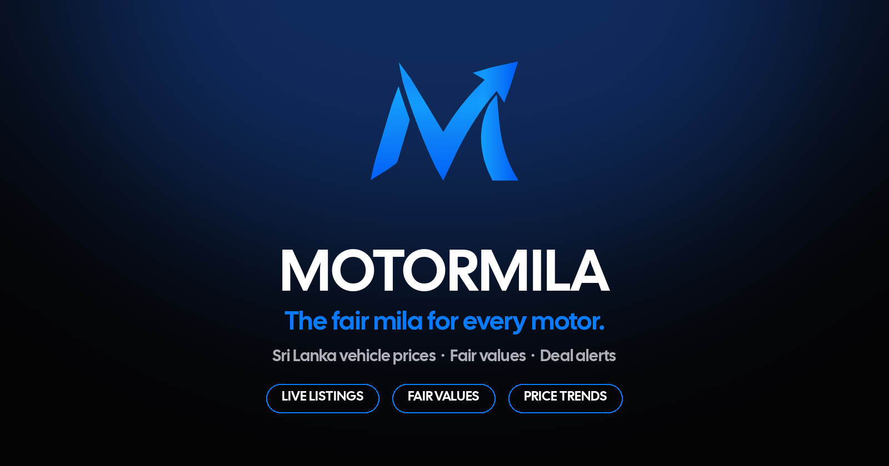

<a href="https://motormila.vercel.app">
<picture>
  <source media="(prefers-color-scheme: light)" srcset="docs/readme/hero-light.png" />
  
</picture>
</a>

 

**One question, answered with evidence: is this vehicle actually worth its asking price?**

 

  

---

## Try it live — no sign-up, no setup

Pick a model and see the market, not just a listing:

[Toyota Prius](https://motormila.vercel.app/cars/toyota/prius) ·
[Toyota Aqua](https://motormila.vercel.app/cars/toyota/aqua) ·
[Toyota Corolla](https://motormila.vercel.app/cars/toyota/corolla) ·
[Toyota Premio](https://motormila.vercel.app/cars/toyota/premio) ·
[Toyota Axio](https://motormila.vercel.app/cars/toyota/axio) ·
[Honda Vezel](https://motormila.vercel.app/cars/honda/vezel) ·
[Honda Fit](https://motormila.vercel.app/cars/honda/fit) ·
[Suzuki Alto](https://motormila.vercel.app/cars/suzuki/alto)

Or start from the top: [motormila.vercel.app](https://motormila.vercel.app) → search any vehicle → open a hub → check its fair value before you call the seller.

---

## A listing vs. Motormila

| A marketplace listing tells you | Motormila adds |
|:--|:--|
| One seller's asking price | What comparable vehicles are actually asking, across marketplaces |
| One photo set, one description | Price history, trends, and district patterns for that model |
| "Contact seller" | A fair-value estimate and deal score — with the evidence shown |
| Nothing about timing | Whether the price is moving, and whether similar vehicles are priced lower |

An advertised price is not a verified sale price, and Motormila never
pretends otherwise. Every number shows its work.

---

## What you get

<table>
<tr>
<td width="50%" valign="top">

### See
Search listings, explore make-and-model hubs, and compare options
side by side — then jump to the original marketplace listing.

### Price
Comparable asking prices, fair-market-value estimates, deal scores,
and outliers. Not a black box: the comparables are visible.

</td>
<td width="50%" valign="top">

### Track
Price history, district patterns, trends, and alerts for vehicles
worth watching. The evidence, in order, before you decide.

### Go deeper
Comparison, listing history, EV / hybrid views, a price index,
geography, and Pro / dealer research tools where available.

</td>
</tr>
</table>

---

## How it works

~~~mermaid
flowchart LR
    A["Marketplaces"] --> B["Collectors"]
    B --> C["Normalize · Dedupe"]
    C --> D["Analysis"]
    D --> E["Web · Android"]
~~~

Sources include ikman, Riyasewana, Auto Lanka, HitAd, AutoDirect,
SaleMe, RiyaHub, Cartivate, and others. A configured source is not a
guarantee of fresh data — coverage, reliability, and anti-bot
protections differ by source, and freshness depends on successful
scheduled runs. Collectors are isolated, so one blocked source stops
nothing else. Public aggregates are delivered as snapshots, and
listings are never presented as confirmed sales.

---

## The brand, in one glance

One mark, one palette, one typeface. Full rules:
[MOTORMILA-BRAND.md](MOTORMILA-BRAND.md).

| | |
|:--|:--|
| **Apex M** | A bold blue M whose final stroke rises into an arrow — *the market, moving the buyer's way.* No badges, no clip-art, no recoloring. |
| **Ink** |  — dark-first ground |
| **Blue** |  — the mark, and actions. Never recolor the mark. |
| **Paper** |  — light surfaces, with the white-bg mark only |
| **Deal Green** |  — underpriced signals only, never in the logo |
| **Cal Sans** | Display for headlines, Cal Sans Text for body and prices |

---

## Built with

---

## Run it locally

~~~bash
# API
cd backend && python -m venv .venv && source .venv/bin/activate
pip install -r requirements.txt
python -m uvicorn app.main:app --reload --host 127.0.0.1 --port 8000

# Web (second terminal, repo root)
npm ci && npm run dev   # → http://localhost:8080
~~~

Local dev only — create a gitignored `backend/.env` with
`ALLOW_SQLITE_FALLBACK=true`, `PRO_ACCESS_ENFORCED=false`,
`APP_ACCESS_ENFORCED=false`. Do not deploy those settings. The local
database starts empty.

Android, checks, and the repo map

~~~bash
# Android (optional)
cd android && ./gradlew :app:assembleDebug

# Checks
npm run typecheck && npm run lint && npm test && npm run build
~~~

~~~text
MotorMila/
├── src/                 React web app
├── public/              Brand assets, metadata, snapshots
├── backend/             FastAPI, scraping, valuation, data
├── android/             Native Android companion
├── scripts/             Export, maintenance, deployment
├── .github/workflows/   CI, scraping, monitoring, releases
└── docs/                Engineering notes, operations, plans
~~~

Docs: [Brand system](MOTORMILA-BRAND.md) · [Android data contract](android/DATA_CONTRACT.md) · [Scraping operations](docs/manus-scraping.md) · [Snapshot delivery](docs/public-snapshots-r2.md) · [Recovery](docs/disaster-recovery-plan.md) · [Roadmap](docs/platform-improvement-roadmap.md)

---

**Less noise. More context. Better decisions.**

[Enter Motormila →](https://motormila.vercel.app)

  

Live: [motormila.vercel.app](https://motormila.vercel.app) ·
[motormila.pages.dev](https://motormila.pages.dev) ·
Email: [hello@ardenostudio.com](mailto:hello@ardenostudio.com) ·
Feedback: [GitHub issues](https://github.com/SuvenSeo/MotorMila/issues)
 
Motormila is not affiliated with ikman, Riyasewana, patpat, or any
marketplace it analyzes. Marketplace names appear only to identify
where a listing originated. Verify the vehicle, seller, documents,
and condition independently before buying.
 
Copyright © 2026 Ardeno Studio. All rights reserved — see
[LICENSE](LICENSE) and [NOTICE](NOTICE). Third-party libraries remain
under their own licences. Motormila has no motormila.lk domain, no
public phone number, and no social or store listings claimed here.

  

