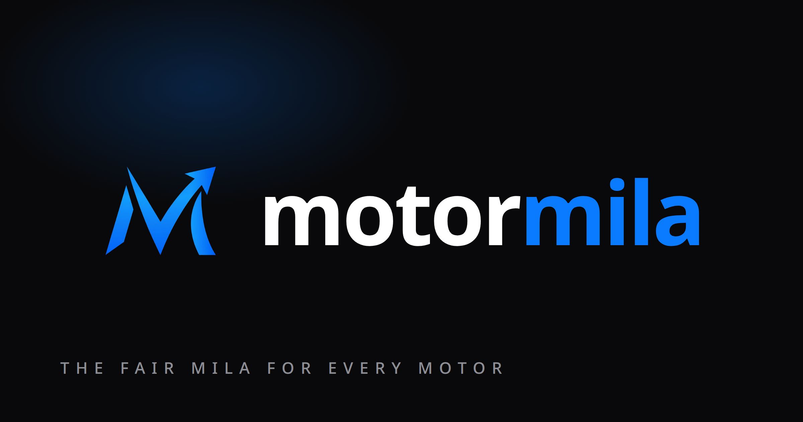
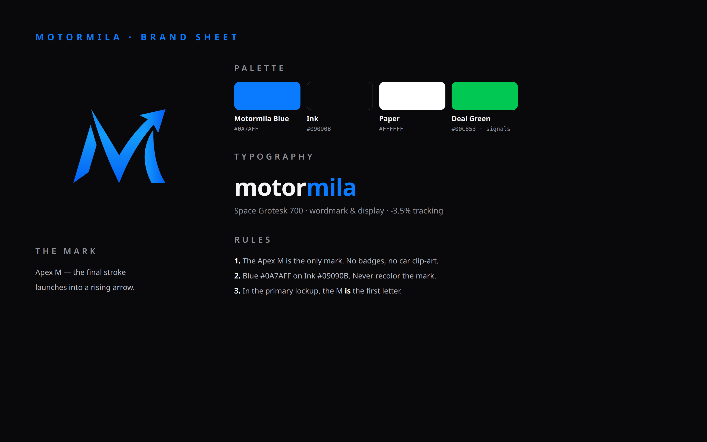

  

A FILM BY ARDENO STUDIO &nbsp;·&nbsp; SRI LANKA &nbsp;·&nbsp; NOW SHOWING

  

 

<h1>THE FAIR MILA FOR EVERY MOTOR.</h1>

<strong>One market. Thousands of signals. One clearer decision.</strong>

  <a href="https://motormila.vercel.app"><strong>▶&nbsp; WATCH IT LIVE</strong></a>
  &nbsp;&nbsp;·&nbsp;&nbsp;
  <a href="#the-story"><strong>THE STORY</strong></a>
  &nbsp;&nbsp;·&nbsp;&nbsp;
  <a href="#the-look"><strong>THE LOOK</strong></a>
  &nbsp;&nbsp;·&nbsp;&nbsp;
  <a href="#the-call-sheet"><strong>THE CALL SHEET</strong></a>
  &nbsp;&nbsp;·&nbsp;&nbsp;
  <a href="#the-fine-print"><strong>THE FINE PRINT</strong></a>

 

&nbsp;

&nbsp;

&nbsp;

&nbsp;

&nbsp;

---

## The logline

> A buyer stands in front of a price and has no way to know if it is fair.
> Motormila gives that price a past, a context, and a comparison — before
> the money moves.

That is the whole film. Everything below is how it is shot.

---

## The story

Every vehicle advertisement in Sri Lanka is a single frame: a price, a
photo, a place, a phone number that may or may not answer. On its own it
tells you what someone *wants*. It does not tell you what comparable
vehicles are advertised for, whether the price has moved, whether the
same vehicle is listed somewhere else, or what that model usually goes
for in that district.

Motormila collects those frames, cleans them, connects them, and turns
them into research tools — for buyers, sellers, dealers, and anyone who
has to answer the question: *is this actually worth it?*

It is not another place to scroll through cars. It is the market behind
the cars, made legible.

---

## The film, in three acts

<table>
<tr>
<td width="33%" valign="top">

### ACT I — SEE

**The market, not just the listing.**

Search and filter listings. Open make-and-model hubs.
Compare options side by side. Jump to the original
marketplace listing, because Motormila never pretends
to be the seller.

*Discover. Compare. Cross-check.*

</td>
<td width="33%" valign="top">

### ACT II — PRICE

**Put every price in context.**

Comparable asking prices. Fair-market-value estimates.
Deal scores and outliers. A price that looks cheap
for a reason, and a price that looks expensive for
no reason, both show their work.

*Value. Score. Question.*

</td>
<td width="33%" valign="top">

### ACT III — DECIDE

**Follow the movement, then commit — or walk away.**

Price history. District patterns. Trends. Alerts for
vehicles worth watching. The evidence, laid out in
order, so the decision is yours and it is informed.

*Track. Watch. Decide.*

</td>
</tr>
</table>

<strong>Full cast of features — open the programme</strong>

 

| Sequence | What it brings together |
|:--|:--|
| **Market overview** | Listing aggregates, trends, price signals, and market activity |
| **Make & model intelligence** | Model-specific listings, asking-price distributions, and research views |
| **Fair Market Value** | Comparable-listing-based valuation estimates |
| **Deal intelligence** | Listing scores, potential underpricing, and curated picks |
| **History & alerts** | Price movements and watched-listing notifications |
| **Geographic insights** | District-level prices, market distribution, and velocity indicators |
| **Deep research** | Comparison tools, listing history, EV and hybrid insights, price index |
| **Pro / dealer** | Deeper research and portfolio tools, subject to plan and access controls |
| **Native Android** | Jetpack Compose companion with mobile-specific navigation and capabilities |

Product access and data availability may vary by feature, plan, and the freshness of each source.

---

## Behind the scenes — the machine

<h3>Many marketplaces. One intelligence layer.</h3>

<em>Collect → Clean → Connect → Understand → Explore</em>

 

~~~mermaid
flowchart TD
    A["Sri Lankan vehicle marketplaces"] --> B["Source collectors Python · Playwright"]
    B --> C["Normalization · validation duplicate detection"]
    C --> D["SQLite · versioned data dumps"]
    D --> E["Market analysis comparables · scoring · trends"]
    E --> F["Static JSON snapshots"]
    E --> G["FastAPI services"]
    F --> H["MotorMila Web React · TypeScript · Vite"]
    G --> H
    G --> I["MotorMila Android Kotlin · Jetpack Compose"]
~~~

Configured sources include ikman, Riyasewana, Auto Lanka, HitAd,
AutoDirect, SaleMe, RiyaHub, Cartivate, and others. Sources differ in
coverage, reliability, and anti-bot protections — a configured
integration is not a guarantee that a source is currently returning
fresh data. Collection runs on a scheduled workflow (see
[.github/workflows/](.github/workflows/)); actual freshness depends on
successful execution and source availability.

### Shot on discipline

| Principle | In practice |
|:--|:--|
| **Traceable sources** | Preserve the context of where a listing originated |
| **Cleaner comparisons** | Normalize fields and detect likely cross-posted listings |
| **Historical perspective** | Track changes instead of treating every advertisement as a timeless fact |
| **Resilient ingestion** | Isolate collectors so one blocked source does not stop the whole pipeline |
| **Efficient delivery** | Serve public market aggregates using exported snapshots where possible |
| **Honest interpretation** | Distinguish advertised asking prices from confirmed sale prices |

---

## The look

This is not a template. This is the Motormila brand, as defined in
[MOTORMILA-BRAND.md](MOTORMILA-BRAND.md) — the only mark, the only
palette, the only typeface. If a screen, poster, or document does not
follow this, it is not Motormila.

 
THE BRAND SHEET — ONE PAGE, EVERY RULE.

### The mark — Apex M

A bold electric-blue **M** whose final stroke launches into a rising
arrow. One idea: *the market, moving the buyer's way.* It doubles as
the initial of the wordmark. It is the only mark — no badges, no car
clip-art, no gradients other than the mark's own blue, no old circular
badge, no speed-lines, no gold “M”, no price-tag clip-art.

| Use | Asset | Notes |
|:--|:--|:--|
| Primary (headers, hero) | `public/logo-wordmark.png` (transparent) | The M is the first letter — never set “motormila” in plain type next to it |
| Dark surfaces | `public/brand-lockup.png` | Pre-composed on Ink |
| App / PWA icon | `public/logo.png` (512, rounded 22%) | Manifest + favicon link |
| Mark only | `public/logo-mark.png` (dark) · `public/logo-mark-light.png` (light) | Follows colour scheme |
| Social / docs | `public/brand-sheet.png` | One-page reference, shown above |
| Link previews | `public/og-card.jpg` (1200×630) | The poster at the top of this page |

Minimum sizes: mark 24px, lockup 120px wide. Below that, use the app
icon. Clearspace: at least the height of the arrowhead on all sides.

### The palette — dark first

| Colour | Hex | Role |
|:--|:--|:--|
| ⬛ **Ink** | `#09090B` | The ground. The brand is dark-first. |
| 🟦 **Motormila Blue** | `#0A7AFF` | The mark, primary actions. Never recolor the mark. |
| ⬜ **Paper** | `#FFFFFF` | Light surfaces only, with the white-bg mark. |
| 🟩 **Deal Green** | `#00C853` | Reserved for underpriced-deal signals. Never in the logo. |

Blue on Ink. On light surfaces, use the white-bg mark — never invert
or recolor the artwork.

### The type — Cal Sans, and only Cal Sans

- **Cal Sans** (display, 600/700, tracking −2%) — headlines.
- **Cal Sans Text** (400/500/600, tabular numbers) — body, UI, and prices.
- Sinhala and Tamil fall back to Noto Sans Sinhala / Noto Sans Tamil.
- Self-hosted in `public/fonts/cal-sans/`. No Google Fonts, no runtime
  font switcher. The logo lockup is artwork (SVG) — never re-set it in
  a live font.

Single source of truth for all of this in code: `src/lib/brand.ts`
(`BRAND.logo`, `BRAND.colors`), rendered on the web by
`src/components/BrandLogo.tsx` and on Android by its `BrandLogo.kt`.

---

## Three formats, one film

<table>
<tr>
<td width="33%" valign="top">

### 🎞️ WEB

**The cinema screen.**

React 18, TypeScript, Vite, Tailwind CSS, data
visualizations, maps, and responsive research views.

<a href="https://motormila.vercel.app">Open the web app →</a>

</td>
<td width="33%" valign="top">

### 🎞️ ENGINE

**The cutting room.**

FastAPI, SQLAlchemy, Python collectors, scheduled
jobs, analytics, and snapshot exports.

<a href="backend/">Explore backend →</a>

</td>
<td width="33%" valign="top">

### 🎞️ ANDROID

**The film in your pocket.**

Kotlin, Jetpack Compose, Hilt, Paging 3, CameraX,
WorkManager, and a mobile-first interface.

<a href="android/">Explore Android →</a>

</td>
</tr>
</table>

### The technology

| Layer | Core technologies |
|:--|:--|
| **Web** | React · TypeScript · Vite · Tailwind CSS · TanStack Query · Recharts · Leaflet |
| **API** | FastAPI · Python · SQLAlchemy |
| **Collection** | Python · Playwright · source-specific scrapers |
| **Data** | SQLite · versioned dumps · exported JSON snapshots · supporting cloud integrations |
| **Android** | Kotlin · Jetpack Compose · Hilt · Paging 3 · CameraX · WorkManager |
| **Delivery** | GitHub Actions · Vercel · Hugging Face Spaces · Cloudflare |
| **Quality** | ESLint · TypeScript · Vitest · pytest · Android unit tests |

<strong>Repository map — the studio floor plan</strong>

~~~text
MotorMila/
├── src/                 React web app: pages, design system, services
├── public/              Brand assets, metadata, and public snapshots
├── backend/             FastAPI, scraping, valuation, and data services
├── android/             Native Android companion
├── api/                 API integration helpers
├── scripts/             Data export, maintenance, deployment tooling
├── .github/workflows/   CI, scraping, monitoring, recovery, releases
└── docs/                Engineering notes, operations, product plans
~~~

---

## The call sheet — run it locally

**Requirements:** Node.js 20+, Python 3.12, and (for Android) JDK 17 plus the Android SDK.

### Scene 1 — Start the API

~~~bash
cd backend
python -m venv .venv

# macOS / Linux
source .venv/bin/activate
# Windows PowerShell: .\.venv\Scripts\Activate.ps1

pip install -r requirements.txt
~~~

Create a local, gitignored **backend/.env** with the following development settings:

~~~dotenv
ALLOW_SQLITE_FALLBACK=true
PRO_ACCESS_ENFORCED=false
APP_ACCESS_ENFORCED=false
~~~

These settings are **for local development only**. They turn off access enforcement; do not deploy them to production.

~~~bash
python -m uvicorn app.main:app --reload --host 127.0.0.1 --port 8000
~~~

The local SQLite database begins empty. Market views may show no data until listings have been imported or collected.

### Scene 2 — Start the web app

Open a second terminal at the repository root:

~~~bash
npm ci
npm run dev
~~~

The frontend runs on **http://localhost:8080** and proxies API requests to the local backend.

### Scene 3 — Build Android (optional)

~~~bash
cd android

# macOS / Linux
./gradlew :app:assembleDebug

# Windows
gradlew.bat :app:assembleDebug
~~~

For emulator-to-local-API builds, use the documented API URL override:

~~~bash
./gradlew :app:assembleDebug -PmotormilaApiUrl=http://10.0.2.2:8000/api/v1
~~~

See the [Windows Android build guide](android/README-WINDOWS-BUILD.md) for SDK/JDK setup and environment details.

### Scene 4 — Run checks

~~~bash
npm run typecheck
npm run lint
npm test
npm run build

# From backend/ with the virtual environment active
python -m pytest tests

# From android/
./gradlew :app:testDebugUnitTest
~~~

The production-oriented web build also runs snapshot-sync and indexing scripts, so it may require network access or appropriately configured data inputs.

---

## Dailies & operations

Motormila is more than a screen on top of scraped listings. The
repository contains the ingestion fleet, analysis services, web
product, native Android client, access controls, deployment automation,
and operational recovery tools.

<strong>Operations & deployments</strong>

 

| System | Implementation |
|:--|:--|
| **Scraper schedules** | GitHub Actions collectors and dump workflows |
| **Data publication** | Merge/analysis/export pipelines and static snapshots |
| **Backend hosting** | Hugging Face Spaces deployment workflow |
| **Web delivery** | Vercel deployment and API routing |
| **Reliability** | Monitoring, maintenance, backup, and disaster recovery workflows |
| **Access** | Invite-based authentication and plan/role-based feature gates |

Key workflows and procedures:

- [Continuous integration](.github/workflows/ci.yml)
- [Scheduled scraping](.github/workflows/manus-scrape-every-2h.yml)
- [Merge to live](.github/workflows/manus-to-live.yml)
- [Backend deployment](.github/workflows/deploy-hf-backend.yml)
- [Disaster recovery plan](docs/disaster-recovery-plan.md)

For production authentication, secrets and permission configuration, use the relevant operational documentation. Never reuse local development bypass settings in a public deployment.

<strong>Engineering documentation</strong>

 

| Reference | Purpose |
|:--|:--|
| [Brand system](MOTORMILA-BRAND.md) | Official Apex M artwork, palette, typography, usage rules |
| [Android data contract](android/DATA_CONTRACT.md) | API and mobile data expectations |
| [Android domain contract](android/DOMAIN_CONTRACT.md) | Domain-level behavior and conventions |
| [Scraping operations](docs/manus-scraping.md) | Collection pipeline and operational notes |
| [Snapshot delivery](docs/public-snapshots-r2.md) | Public data exports and delivery |
| [Recovery](docs/disaster-recovery-plan.md) | Restoration and incident procedures |
| [Product roadmap](docs/platform-improvement-roadmap.md) | Planned improvements and development direction |

---

## The fine print

MotorMila analyzes information from vehicle advertisements and related
sources. **An advertised price is not a verified transaction price**,
and a model-derived fair-value estimate is not an inspection, appraisal,
or guarantee. Listings can be stale, incomplete, duplicated, incorrect,
or unavailable.

Use the insights as **decision support**. Verify the vehicle, seller,
documents, condition, and current listing details independently before
committing to a purchase.

Motormila is not affiliated with ikman, Riyasewana, patpat, or any
marketplace whose listings it analyzes. Marketplace names appear only
to identify where a listing originated.

### Contact

| | |
|:--|:--|
| **Live platform** | [motormila.vercel.app](https://motormila.vercel.app) — also served at [motormila.pages.dev](https://motormila.pages.dev) |
| **Email** | [hello@ardenostudio.com](mailto:hello@ardenostudio.com) |
| **Feedback** | [GitHub issues](https://github.com/SuvenSeo/MotorMila/issues) |

Motormila has no motormila.lk domain, no public phone number, and no
social or store listings claimed in this repository. If you see one, it
is not an official Motormila channel — contact the email above to
verify.

### Rights

Copyright © 2026 Ardeno Studio. All rights reserved. No licence is
granted by this repository: do not copy, reuse, redistribute, or
present this code, brand assets, or data as your own without written
permission. See [LICENSE](LICENSE) and [NOTICE](NOTICE). For licensing
enquiries, contact [hello@ardenostudio.com](mailto:hello@ardenostudio.com).

Third-party libraries and tools in this repository remain under their
own licences, which are preserved in their respective packages.

---

<h3>THE FAIR MILA FOR EVERY MOTOR.</h3>

<strong>Less noise. More context. Better decisions.</strong>

  <a href="https://motormila.vercel.app"><strong>ENTER MOTORMILA →</strong></a>
  &nbsp;&nbsp;·&nbsp;&nbsp;
  <a href="https://github.com/SuvenSeo/MotorMila/issues">ISSUES & FEEDBACK</a>
  &nbsp;&nbsp;·&nbsp;&nbsp;
  <a href="MOTORMILA-BRAND.md">THE BRAND</a>
  &nbsp;&nbsp;·&nbsp;&nbsp;
  <a href="mailto:hello@ardenostudio.com">CONTACT</a>

 

DESIGNED AND BUILT FOR SRI LANKA. POWERED BY DATA. GUIDED BY CLARITY.
 
A FILM BY ARDENO STUDIO.

